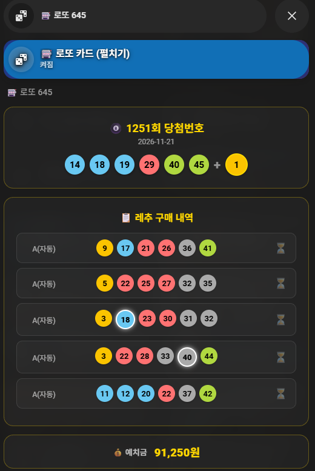
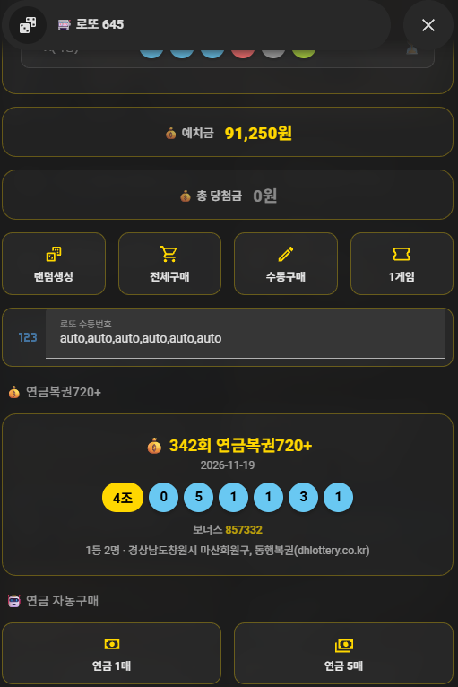
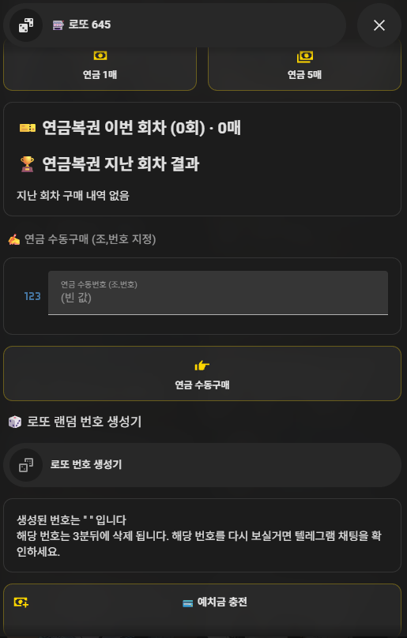

# DH Lottery Home Assistant Add-on

[](https://my.home-assistant.io/redirect/supervisor_add_addon_repository/?repository_url=https%3A%2F%2Fgithub.com%2Fredchupa%2Fha-app-dhlottery)

[](LICENSE)
[](https://github.com/redchupa/ha-app-dhlottery/stargazers)

Home Assistant에서 **동행복권 로또 6/45를 자동으로 구매하고 분석**할 수 있는 애드온입니다.
실시간 당첨 결과, 통계 분석(Hot/Cold), 예치금 관리, MQTT Discovery, REST API를 한 번에 제공합니다.

---

## 실제 사용 화면

<table>
  <tr>
    <td align="center" width="33%">
      <b>🎰 로또 6/45 당첨번호 & 구매 내역</b><br/>
      
    </td>
    <td align="center" width="33%">
      <b>💰 예치금 · 원클릭 구매 · 연금복권</b><br/>
      
    </td>
    <td align="center" width="33%">
      <b>✍️ 연금 구매내역 · 수동구매 · 랜덤생성</b><br/>
      
    </td>
  </tr>
</table>

---

## 주요 기능

- ✅ **자동 구매**: 번호 랜덤 자동 구매 (1게임 / 5게임)
- ✅ **수동 구매**: 번호 수동 입력 + 자동 혼합 (예: `1,2,3,auto,auto,auto`)
- ✅ **가족용 다중 계정 지원**: 최대 **4개 계정**까지 지원 (계정 간 20초 보안 간격 적용)
- ✅ **주간 구매 한도 보호**: 1계정당 주간 최대 **5게임(5,000원)** 강제 제한
- ✅ **실시간 분석**: 당첨번호·상금·통계 자동 업데이트
- ✅ **자동화 연동**: HA 자동화 트리거/액션 지원
- ✅ **통계 분석**: Hot / Cold 번호, 출현 빈도
- ✅ **예치금 관리**: 잔액 및 구매 가능 금액 모니터링
- ✅ **MQTT Discovery**: HA 자동 통합
- ✅ **REST API**: 외부 시스템 연동 + Swagger UI
- ✅ **모바일 알림**: 구매 완료, 당첨번호 발표 알림
- ✅ **사이드바 대시보드** (v2.5.0~): 구매 내역 조회 + 구매 버튼, 테마 12종·개인화 설정 (v2.6.0)
- ✅ **아이디 비공개**: 웹 UI·API·애드온 로그에는 실제 아이디 대신 `Account_1`, `Account_2` 로 표시

---

## 목차

- [실제 사용 화면](#실제-사용-화면)
- [설치](#설치)
- [사이드바 대시보드](#사이드바-대시보드)
- [대시보드 카드 예시](#대시보드-카드-예시-2계정-기준)
- [사용 전 필수 체크](#사용-전-필수-체크)
- [다중 계정 사용 및 자동화 주의사항](#다중-계정-사용-및-자동화-주의사항)
- [생성되는 센서](#생성되는-센서)
- [버튼 엔티티](#버튼-엔티티)
- [REST API](#rest-api)
- [문제 해결](#문제-해결)
- [참고 사항](#참고-사항)
- [후원](#-후원)
- [라이선스](#라이선스)
- [면책 조항](#면책-조항)

---

## 설치

### 저장소 추가

1. Home Assistant → **Settings** → **Add-ons** → **Add-on Store**
2. 우측 상단 메뉴(⋮) → **Repositories**
3. 다음 URL 추가:
   ```
   https://github.com/redchupa/ha-app-dhlottery
   ```

### 애드온 설치

1. Add-on Store에서 **DH Lotto 45** 선택
2. **Install** 클릭
3. Configuration 탭에서 설정 (최대 **4개 계정**까지 등록 가능):

```yaml
accounts:
  - username: "my_account_1"   # 동행복권 아이디
    password: "my_password_1"  # 동행복권 비밀번호
    enabled: true
  # 가족 구성원 추가 시 (최대 4계정까지만 로드됨)
  # - username: "family_account_2"
  #   password: "family_password_2"
  #   enabled: true
update_interval: 3600   # 센서 갱신 주기(초), 기본 1시간
mqtt_url: "mqtt://homeassistant.local:1883"
mqtt_username: ""
mqtt_password: ""
```

4. **Start** 클릭 → **Log** 탭에서 `Login successful` 확인

---

## 사이드바 대시보드

v2.5.0 부터 애드온의 **웹 UI 가 대시보드**로 바뀌었습니다. 구매한 복권 조회와 구매를 한 화면에서 할 수 있습니다.

**사이드바에 표시하기**: 설정 → 애드온(앱) → DH Lotto 45 → **사이드바에 표시** 켜기. 왼쪽 메뉴에 `DH Lotto 45` 가 생깁니다.

| 카드 | 내용 |
|---|---|
| 계정 요약 | 예치금, 구매 가능 금액, 로그인·동기화 상태 |
| 구매하기 | 로또 자동 1·5게임, 수동 1게임 / 연금복권 자동 1·5매, 수동 1매 (구매 전 확인 창) |
| 로또 이번·지난 회차 | 구매 번호와 결과, 지난 회차 당첨번호 |
| 연금복권 이번·지난 회차 | 구매한 조·번호와 결과, 당첨 요약 |
| 최신 당첨번호 | 로또 6/45, 연금복권720+ |

- 계정은 실제 아이디 대신 `Account_1`, `Account_2` … (애드온 설정 순서)로 표시됩니다.
- 구매 버튼에도 기존 보호 장치(주간 5게임, 연금 1일 한도, 계정 간 20초 간격, 15초 중복 방지)가 그대로 적용됩니다.
- 로또 구매 불가 시간(토 20:00 ~ 일 06:00)에는 로또 버튼이 잠깁니다.

### 테마 · 개인화 (v2.6.0)

상단 **테마 버튼(⚙️ 설정)** 에서 화면을 꾸밀 수 있고, 설정은 HA에 저장돼 모든 기기에 똑같이 적용됩니다.

| 그룹 | 테마 |
|---|---|
| 기본 | 시스템 자동 · 라이트 · 다크 · HA 블루 |
| 행운 | 잭팟 골드 · 네잎클로버 · 복주머니 · 황금돼지 · 로또볼 팝 |
| 밤하늘 · 미래 | 네온 추첨기 · 오로라 · 은하수 소원 |

- **행운 배너**: 오늘의 행운 문구, 로또·연금 다음 추첨 카운트다운, 최신 당첨번호, 지난 회차 1등 당첨금
- **🍀 행운 번호 뽑기**: 수동 번호 칸을 무작위 번호로 채움 (구매는 확인 창을 거쳐야 진행)
- **당첨 축하**: 지난 회차 당첨 티켓이 있으면 금색 배너와 꽃가루, 1등이면 잭팟 배너
- **설정 항목**: 언어(한국어/English), 간격, 로또볼 모양(입체/평면), 애니메이션, 행운 배너, 나만의 행운 문구, 기본 계정, 카드 표시·순서

**보안**: 대시보드 데이터와 구매는 **HA 사이드바(Ingress)로 열었을 때만** 동작합니다. HA 로그인을 거친 요청만 통과하고, 포트 60099 로 직접 접속하면 차단됩니다. 구매 요청에는 페이지별 보안 토큰(CSRF)이 필요하며, 다른 사이트에서 사용자의 HA 세션으로 구매를 시도할 수 없도록 CORS 자격증명을 막았습니다. 화면은 CSP 로 보호됩니다.

---

## 사용 전 필수 체크

1. 동행복권 사이트 https://www.dhlottery.co.kr 에서  
   회원가입 → 로그인 → 마이페이지 → **건전구매 서약하기** (필수)
2. 자동 구매를 위해 **예치금 충전** 필요

---

## 다중 계정 사용 및 자동화 주의사항

> [!IMPORTANT]
> **다중 계정 사용 시 동시 구매는 불가능합니다.**
> 오프라인 복권 판매점 보호, 서버 부하 방지 및 건전한 복권 구매 문화 유지를 위해 아래와 같은 보안 정책이 코드 레벨에 적용되어 있습니다.

### 적용된 보안 제한 정책
1. **최대 4계정 제한**: 동일 가구(가족 구성원)의 개별 동의 하에 최대 **4개 계정**까지만 등록 및 로드됩니다. (4개 초과 설정 시 상위 4개만 로드되며 나머지는 무시됩니다.)
2. **1계정당 주간 최대 5게임(5,000원) 제한**: 로또 6/45는 오프라인 판매점 매출 보호 및 사행성 방지 규정에 따라 **계정당 주간 최대 5게임**까지만 구매할 수 있도록 강제 제한됩니다.
3. **연금복권 720+ 1일 구매 상한선(Hard Limit)**: 자동화 버그로 예치금이 한 번에 소진되는 오구매 사고를 방지하기 위해, 연금복권은 **1계정당 1일 최대 5매(5,000원)**까지만 구매할 수 있도록 코드 레벨 상한선이 적용되어 있습니다.
4. **계정 간 20초 구매 간격 (동시 구매 차단)**:
   - A 계정이 구매 및 구매 정보 조회를 진행 중일 때는 다른 계정(B)의 구매 요청이 즉시 차단됩니다.
   - A 계정의 구매 및 구매 정보 조회가 완료된 시점부터 **최소 20초**가 지나야 다른 계정(B)으로 구매할 수 있습니다.
   - 20초 이내에 다른 계정으로 구매를 시도하면 구매가 실행되지 않으며, 해당 계정의 오류 센서(`sensor.dhlotto_{username}_lotto45_purchase_error`)에 남은 대기 시간이 표시됩니다.
5. **폴링 하한선 및 랜덤 지연(Jitter)**: 서버 부하 방지를 위해 센서 갱신 주기는 **최소 1,800초(30분)** 이상으로 제한되며, 요청 집중을 막기 위해 랜덤 지연(Jitter)이 자동 적용됩니다.

### Home Assistant 자동화 작성 가이드

다중 계정을 사용하는 경우, **하나의 자동화에서 여러 계정의 구매 버튼을 동시에 누르면 두 번째 계정부터 보안 로직에 의해 차단**됩니다.
반드시 아래 예시처럼 **계정 사이에 최소 30초 이상의 `delay`를 두거나**, 계정별로 자동화 실행 시각을 다르게 설정해 주세요.

```yaml
# ✅ 올바른 자동화 예시 (계정 간 충분한 지연 시간 추가)
alias: "가족 로또 자동 구매"
trigger:
  - platform: time
    at: "10:15:00"
action:
  # 1) 첫 번째 계정 구매
  - service: button.press
    target:
      entity_id: button.dhlotto_account1_buy_auto_5

  # 2) 구매 및 조회 완료 + 20초 보안 간격 확보를 위해 30초 이상 대기
  - delay: "00:00:30"

  # 3) 두 번째 계정 구매
  - service: button.press
    target:
      entity_id: button.dhlotto_account2_buy_auto_5
```

> [!TIP]
> 매주 토요일 마감 직전(19:50~20:00)이나 정각(09:00, 10:00 등)에 트래픽이 몰리는 시간대는 피하고, 여유 있는 시간대에 계정별로 1분 이상 간격을 두어 자동화를 분산 실행하는 것을 권장합니다.

---

## 대시보드 카드 예시 (2계정 기준)

위 스크린샷과 동일한 대시보드 카드를 그대로 복사해 사용하실 수 있습니다.

### 사전 준비 (HACS 프론트엔드 카드)
- [Bubble Card](https://github.com/Clooos/Bubble-Card) (`custom:bubble-card`)
- [button-card](https://github.com/custom-cards/button-card) (`custom:button-card`)
- *(선택)* 카드 펼치기/접기 토글용 Helper: `input_boolean.lazy_lotto` (설정 → 기기 및 서비스 → 도우미에서 토글 생성)

### 적용 방법
1. 아래 YAML(또는 [examples/dashboard_multi_account.yaml](examples/dashboard_multi_account.yaml))을 복사합니다.
2. 코드 내 `account1`, `account2`를 본인의 동행복권 아이디로 일괄 치환합니다. *(단일 계정만 사용 시 `account2` 영역만 삭제하시면 됩니다.)*
3. Home Assistant 대시보드 → **편집** → **카드 추가** → **수동(YAML)** 에 붙여넣어 저장합니다.

<details>
<summary><b>📋 2계정 대시보드 카드 YAML 전체 코드 펼치기 (클릭하여 복사)</b></summary>

```yaml
type: custom:bubble-card
card_type: pop-up
hash: '#pop-up-lotto'
name: 🎰 로또 645
icon: mdi:dice-multiple
button_type: name
styles: |-
  .bubble-pop-up {
    height: 90vh !important;
  }
sub_button:
  main: []
  bottom: []
slider_fill_orientation: left
slider_value_position: right
cards:
- type: custom:bubble-card
  card_type: button
  button_type: switch
  entity: input_boolean.lazy_lotto
  name: 🎰 로또 카드 (펼치기)
  icon: mdi:dice-multiple
  show_state: true
  tap_action:
    action: toggle
  styles: |
    /* lazy-hero */
    .bubble-button-card-container {
      background: linear-gradient(135deg, #1e3a8a 0%, #6366f1 100%) !important;
      position: relative !important;
      min-height: 64px !important;
      border-radius: 16px !important;
      overflow: hidden !important;
      box-shadow: 0 4px 14px rgba(0,0,0,0.18) !important;
    }
    .bubble-button-card-container::before {
      content: '';
      position: absolute;
      inset: 0;
      background: linear-gradient(135deg, rgba(0,0,0,0.05) 0%, rgba(0,0,0,0.55) 100%);
      border-radius: 16px;
      z-index: 0;
      pointer-events: none;
    }
    .bubble-button-card-container > * {
      position: relative !important;
      z-index: 2 !important;
    }
    .bubble-name, .bubble-state, .bubble-sub-button {
      color: #fff !important;
      text-shadow: 0 1px 3px rgba(0,0,0,0.95), 0 0 8px rgba(0,0,0,0.7) !important;
      font-weight: 700 !important;
    }
    .bubble-name { font-size: 16px !important; }
    .bubble-icon, .bubble-icon-container {
      color: #fff !important;
      --mdc-icon-size: 24px !important;
      filter: drop-shadow(0 1px 3px rgba(0,0,0,0.95)) !important;
    }
    .bubble-icon-container {
      background: rgba(255,255,255,0.18) !important;
      backdrop-filter: blur(6px) !important;
      -webkit-backdrop-filter: blur(6px) !important;
      border-radius: 50% !important;
    }
- type: conditional
  conditions:
  - condition: state
    entity: input_boolean.lazy_lotto
    state: 'on'
  card:
    type: vertical-stack
    cards:
    - type: heading
      heading: 🎰 로또 645
      heading_style: subtitle
    - type: vertical-stack
      cards:
      - type: custom:button-card
        entity: sensor.dhlotto_account1_lotto645_winning_numbers
        show_name: false
        show_state: false
        show_icon: false
        styles:
          card:
          - background: rgba(255, 255, 255, 0.03)
          - border: 1px solid rgba(255, 215, 0, 0.3)
          - border-radius: 16px
          - padding: 20px
          - backdrop-filter: blur(10px)
          grid:
          - grid-template-areas: '"content"'
          - grid-template-columns: 1fr
          - grid-template-rows: 1fr
          custom_fields:
            content:
            - display: flex
            - justify-content: center
            - width: 100%
        custom_fields:
          content: |
            [[[
              const round =
                states['sensor.dhlotto_account1_lotto645_round']?.state || '';

              const rawNums =
                (entity.state.match(/\d+/g) || []).map(n => n.trim());

              const filtered = rawNums.filter(n => n !== String(round));

              if (filtered.length < 7) {
                return `<div style="color:#888;text-align:center;">당첨번호 데이터 오류</div>`;
              }

              const winNums = filtered.slice(0, 6);
              const bonus   = filtered[6];

              const drawDate =
                states['sensor.dhlotto_account1_lotto645_draw_date']?.state || '';

              function color(n) {
                n = parseInt(n);
                if (n <= 9) return '#fbc400';
                if (n <= 19) return '#69c8f2';
                if (n <= 29) return '#ff7272';
                if (n <= 39) return '#aaa';
                return '#b0d840';
              }

              let out = `
                <div style="width:100%;display:flex;flex-direction:column;align-items:center;">

                  <div style="font-size:18px;font-weight:700;color:gold;margin-bottom:4px;">
                    🎱 ${round}회 당첨번호
                  </div>

                  <div style="font-size:12px;opacity:0.65;margin-bottom:12px;">
                    ${drawDate}
                  </div>

                  <div style="display:flex;gap:8px;align-items:center;">
              `;

              winNums.forEach(n => {
                out += `
                  <div style="
                    width:33px;height:33px;border-radius:50%;
                    background:${color(n)};
                    display:flex;align-items:center;justify-content:center;
                    font-weight:700;font-size:15px;color:#000;
                    box-shadow:0 2px 6px rgba(0,0,0,0.3);
                  ">${n}</div>
                `;
              });

              out += `
                <div style="font-size:20px;font-weight:700;opacity:0.6;">+</div>

                <div style="
                  width:33px;height:33px;border-radius:50%;
                  background:${color(bonus)};
                  display:flex;align-items:center;justify-content:center;
                  font-weight:700;font-size:15px;color:#000;
                  border:2px solid gold;
                  box-shadow:0 2px 6px rgba(0,0,0,0.3);
                ">${bonus}</div>

              </div></div>`;

              return out;
            ]]]
      - type: custom:button-card
        entity: sensor.dhlotto_account1_lotto45_game_1
        show_name: false
        show_state: false
        show_icon: false
        styles:
          card:
          - background: rgba(255, 255, 255, 0.03)
          - border: 1px solid rgba(255, 215, 0, 0.3)
          - border-radius: 16px
          - padding: 20px
          - backdrop-filter: blur(10px)
          grid:
          - grid-template-areas: '"content"'
          - grid-template-columns: 1fr
        custom_fields:
          content: |
            [[[
              const winEnt = states['sensor.dhlotto_account1_lotto645_winning_numbers'];
              const winNums =
                winEnt &&
                winEnt.state &&
                !['unknown','unavailable','none',''].includes(winEnt.state)
                  ? winEnt.state.split(/[, ]+/).map(n => n.trim())
                  : [];

              const histList = [
                'sensor.dhlotto_account1_lotto45_game_1',
                'sensor.dhlotto_account1_lotto45_game_2',
                'sensor.dhlotto_account1_lotto45_game_3',
                'sensor.dhlotto_account1_lotto45_game_4',
                'sensor.dhlotto_account1_lotto45_game_5'
              ];

              function histColor(num) {
                const n = parseInt(num);
                if (n <= 10) return '#fbc400';
                if (n <= 20) return '#69c8f2';
                if (n <= 30) return '#ff7272';
                if (n <= 40) return '#aaa';
                return '#b0d840';
              }

              function resultIcon(state) {
                if (!state) return '<span style="opacity:.6;">⏳</span>';

                const s = String(state).trim();

                if (['미추첨','확인중','unknown','unavailable',''].includes(s))
                  return '<span style="opacity:.6;">⏳</span>';

                if (s === '낙첨')
                  return '<span style="color:#f44;">❌</span>';

                const match = s.match(/([1-5])등/);
                if (match) {
                  return `
                    <span style="
                      display:flex;
                      justify-content:flex-end;
                      align-items:center;
                      gap:4px;
                      color:gold;
                      font-weight:800;
                    ">
                      🏆 <span style="font-size:13px;">${match[1]}</span>
                    </span>
                  `;
                }

                return '<span style="opacity:.6;">⏳</span>';
              }

              let items = '';

              for (let i = 0; i < histList.length; i++) {
                const ent = states[histList[i]];
                if (!ent || ['unavailable','unknown','none',''].includes(ent.state)) continue;

                const resultEnt = states[histList[i] + '_result'];
                const resultValue =
                  resultEnt && resultEnt.state ? resultEnt.state : '확인중';

                const slot = ent.attributes['슬롯'] || String.fromCharCode(65 + i);
                const mode = ent.attributes['선택'] || '자동';

                const isWin = resultValue.includes('등');
                const isLose = resultValue === '낙첨';

                const nums = ent.state.split(/[, ]+/).map(n => n.trim()).filter(n => n);
                if (nums.length < 6) continue;

                let balls = `<div style="flex:1;display:flex;justify-content:center;gap:6px;">`;

                for (const n of nums) {
                  const isMatch = winNums.includes(String(n));

                  balls += `
                    <div style="
                      width:28px;
                      height:28px;
                      border-radius:50%;
                      background:${histColor(n)};
                      display:flex;
                      align-items:center;
                      justify-content:center;
                      font-weight:${isMatch ? 900 : 700};
                      font-size:13px;
                      color:#000;
                      box-shadow:${isMatch
                        ? '0 0 8px rgba(255,255,255,0.9)'
                        : '0 2px 4px rgba(0,0,0,0.2)'};
                      border:${isMatch ? '2px solid #fff' : 'none'};
                    ">${n}</div>
                  `;
                }

                balls += '</div>';

                let resultStyle = 'color:rgba(255,255,255,0.6);';
                if (isWin) resultStyle = 'color:gold;font-weight:800;';
                else if (isLose) resultStyle = 'color:#f44;opacity:.85;';

                items += `
                  <div style="
                    display:flex;
                    align-items:center;
                    padding:10px 12px;
                    background:${isWin ? 'rgba(255,215,0,0.15)' : 'rgba(255,255,255,0.03)'};
                    border-radius:10px;
                    border:1px solid ${isWin ? 'gold' : 'rgba(255,255,255,0.1)'};
                    margin-bottom:8px;
                  ">
                    <div style="width:65px;font-size:12px;color:rgba(255,255,255,0.6);">
                      ${slot}(${mode})
                    </div>

                    ${balls}

                    <div style="width:65px;font-size:18px;text-align:right;${resultStyle}">
                      ${resultIcon(resultValue)}
                    </div>
                  </div>
                `;
              }

              if (!items) {
                return '<div style="padding:20px;text-align:center;color:grey;">구매 내역 데이터가 없습니다.</div>';
              }

              return `
                <div style="width:100%;display:flex;flex-direction:column;align-items:center;">
                  <div style="font-size:16px;font-weight:700;color:gold;margin-bottom:14px;">
                    📋 계정 1 구매 내역
                  </div>
                  <div style="display:flex;flex-direction:column;width:100%;">
                    ${items}
                  </div>
                </div>
              `;
            ]]]
      - type: custom:button-card
        entity: sensor.dhlotto_account1_lotto45_balance
        show_name: false
        show_state: false
        show_icon: false
        styles:
          card:
          - background: rgba(255, 255, 255, 0.03)
          - border: 1px solid rgba(255, 215, 0, 0.3)
          - border-radius: 16px
          - padding: 14px 16px
          - backdrop-filter: blur(10px)
          grid:
          - grid-template-areas: '"content"'
          - grid-template-columns: 1fr
          - grid-template-rows: 1fr
        custom_fields:
          content: |
            [[[
              const value = parseInt(entity.state) || 0;
              const won = value.toLocaleString('ko-KR');

              return `
                <div style="
                  width:100%;
                  display:flex;
                  align-items:center;
                  justify-content:center;
                  gap:12px;
                ">
                  <div style="
                    font-size:13px;
                    font-weight:600;
                    color:rgba(255,255,255,0.7);
                    white-space:nowrap;
                  ">
                    💰 예치금
                  </div>

                  <div style="
                    font-size:18px;
                    font-weight:800;
                    color:${value > 0 ? 'gold' : '#888'};
                    letter-spacing:0.3px;
                    white-space:nowrap;
                  ">
                    ${won}원
                  </div>
                </div>
              `;
            ]]]
      - type: custom:button-card
        entity: sensor.dhlotto_account1_lotto45_total_winning
        show_name: false
        show_state: false
        show_icon: false
        styles:
          card:
          - background: rgba(255, 255, 255, 0.03)
          - border: 1px solid rgba(255, 215, 0, 0.3)
          - border-radius: 16px
          - padding: 14px 16px
          - backdrop-filter: blur(10px)
          grid:
          - grid-template-areas: '"content"'
          - grid-template-columns: 1fr
          - grid-template-rows: 1fr
        custom_fields:
          content: |
            [[[
              const value = parseInt(entity.state) || 0;
              const won = value.toLocaleString('ko-KR');

              return `
                <div style="
                  width:100%;
                  display:flex;
                  align-items:center;
                  justify-content:center;
                  gap:12px;
                ">
                  <div style="
                    font-size:13px;
                    font-weight:600;
                    color:rgba(255,255,255,0.7);
                    white-space:nowrap;
                  ">
                    💰 총 당첨금
                  </div>

                  <div style="
                    font-size:18px;
                    font-weight:800;
                    color:${value > 0 ? 'gold' : '#888'};
                    letter-spacing:0.3px;
                    white-space:nowrap;
                  ">
                    ${won}원
                  </div>
                </div>
              `;
            ]]]
      - type: horizontal-stack
        cards:
        - type: custom:button-card
          entity: button.dhlotto_account1_generate_random
          name: 랜덤생성
          icon: mdi:dice-multiple-outline
          show_state: false
          tap_action:
            action: call-service
            service: button.press
            service_data:
              entity_id: button.dhlotto_account1_generate_random
          confirmation:
            text: 랜덤 번호를 생성하시겠습니까?
          styles:
            card:
            - background: rgba(255, 255, 255, 0.05)
            - border: 1px solid rgba(255, 215, 0, 0.3)
            - border-radius: 12px
            - padding: 12px 8px
            - backdrop-filter: blur(10px)
            icon:
            - color: gold
            - width: 22px
            name:
            - font-size: 12px
            - font-weight: 600
            - color: rgba(255, 255, 255, 0.9)
            - margin-top: 4px
            grid:
            - grid-template-areas: '"i" "n"'
            - grid-template-rows: 1fr min-content
        - type: custom:button-card
          entity: button.dhlotto_account1_buy_auto_5
          name: 전체구매
          icon: mdi:cart-outline
          show_state: false
          tap_action:
            action: call-service
            service: button.press
            service_data:
              entity_id: button.dhlotto_account1_buy_auto_5
          confirmation:
            text: 로또 5게임을 구매하시겠습니까?
          styles:
            card:
            - background: rgba(255, 255, 255, 0.05)
            - border: 1px solid rgba(255, 215, 0, 0.3)
            - border-radius: 12px
            - padding: 12px 8px
            - backdrop-filter: blur(10px)
            icon:
            - color: gold
            - width: 22px
            name:
            - font-size: 12px
            - font-weight: 600
            - color: rgba(255, 255, 255, 0.9)
            - margin-top: 4px
            grid:
            - grid-template-areas: '"i" "n"'
            - grid-template-rows: 1fr min-content
        - type: custom:button-card
          entity: button.dhlotto_account1_buy_manual
          name: 수동구매
          icon: mdi:pencil-outline
          show_state: false
          tap_action:
            action: call-service
            service: button.press
            service_data:
              entity_id: button.dhlotto_account1_buy_manual
          confirmation:
            text: 수동으로 로또를 구매하시겠습니까?
          styles:
            card:
            - background: rgba(255, 255, 255, 0.05)
            - border: 1px solid rgba(255, 215, 0, 0.3)
            - border-radius: 12px
            - padding: 12px 8px
            - backdrop-filter: blur(10px)
            icon:
            - color: gold
            - width: 22px
            name:
            - font-size: 12px
            - font-weight: 600
            - color: rgba(255, 255, 255, 0.9)
            - margin-top: 4px
            grid:
            - grid-template-areas: '"i" "n"'
            - grid-template-rows: 1fr min-content
        - type: custom:button-card
          entity: button.dhlotto_account1_buy_auto_1
          name: 1게임
          icon: mdi:ticket-outline
          show_state: false
          tap_action:
            action: call-service
            service: button.press
            service_data:
              entity_id: button.dhlotto_account1_buy_auto_1
          confirmation:
            text: 로또 1게임을 구매하시겠습니까?
          styles:
            card:
            - background: rgba(255, 255, 255, 0.05)
            - border: 1px solid rgba(255, 215, 0, 0.3)
            - border-radius: 12px
            - padding: 12px 8px
            - backdrop-filter: blur(10px)
            icon:
            - color: gold
            - width: 22px
            name:
            - font-size: 12px
            - font-weight: 600
            - color: rgba(255, 255, 255, 0.9)
            - margin-top: 4px
            grid:
            - grid-template-areas: '"i" "n"'
            - grid-template-rows: 1fr min-content
      - type: entities
        entities:
        - entity: text.dhlotto_account1_lotto_manual_numbers
          name: 로또 수동번호
        card_mod:
          style: |
            ha-card {
              height: 64px;
              background: rgba(255, 255, 255, 0.05);
              border: 1px solid rgba(255, 215, 0, 0.3);
              border-radius: 12px;
              padding: 0 8px;
              display: flex;
              align-items: center;
              box-sizing: border-box;
            }

            .card-content {
              padding: 0 !important;
              width: 100%;
            }

            hui-input-text-entity-row {
              width: 100%;
            }

            ha-textfield {
              height: 40px;
              --mdc-theme-primary: gold;
              --mdc-text-field-fill-color: transparent;
            }
      visibility:
      - condition: user
        users:
        - 220063f4ced745a1b14c4a5b1476c4d2
    - type: vertical-stack
      cards:
      - type: custom:button-card
        entity: sensor.dhlotto_account2_lotto645_winning_numbers
        show_name: false
        show_state: false
        show_icon: false
        styles:
          card:
          - background: rgba(255, 255, 255, 0.03)
          - border: 1px solid rgba(255, 215, 0, 0.3)
          - border-radius: 16px
          - padding: 20px
          - backdrop-filter: blur(10px)
          grid:
          - grid-template-areas: '"content"'
          - grid-template-columns: 1fr
          - grid-template-rows: 1fr
          custom_fields:
            content:
            - display: flex
            - justify-content: center
            - width: 100%
        custom_fields:
          content: |
            [[[
              const round =
                states['sensor.dhlotto_account2_lotto645_round']?.state || '';

              const rawNums =
                (entity.state.match(/\d+/g) || []).map(n => n.trim());

              const filtered = rawNums.filter(n => n !== String(round));

              if (filtered.length < 7) {
                return `<div style="color:#888;text-align:center;">당첨번호 데이터 오류</div>`;
              }

              const winNums = filtered.slice(0, 6);
              const bonus   = filtered[6];

              const drawDate =
                states['sensor.dhlotto_account2_lotto645_draw_date']?.state || '';

              function color(n) {
                n = parseInt(n);
                if (n <= 9) return '#fbc400';
                if (n <= 19) return '#69c8f2';
                if (n <= 29) return '#ff7272';
                if (n <= 39) return '#aaa';
                return '#b0d840';
              }

              let out = `
                <div style="width:100%;display:flex;flex-direction:column;align-items:center;">

                  <div style="font-size:18px;font-weight:700;color:gold;margin-bottom:4px;">
                    🎱 ${round}회 당첨번호
                  </div>

                  <div style="font-size:12px;opacity:0.65;margin-bottom:12px;">
                    ${drawDate}
                  </div>

                  <div style="display:flex;gap:8px;align-items:center;">
              `;

              winNums.forEach(n => {
                out += `
                  <div style="
                    width:33px;height:33px;border-radius:50%;
                    background:${color(n)};
                    display:flex;align-items:center;justify-content:center;
                    font-weight:700;font-size:15px;color:#000;
                    box-shadow:0 2px 6px rgba(0,0,0,0.3);
                  ">${n}</div>
                `;
              });

              out += `
                <div style="font-size:20px;font-weight:700;opacity:0.6;">+</div>

                <div style="
                  width:33px;height:33px;border-radius:50%;
                  background:${color(bonus)};
                  display:flex;align-items:center;justify-content:center;
                  font-weight:700;font-size:15px;color:#000;
                  border:2px solid gold;
                  box-shadow:0 2px 6px rgba(0,0,0,0.3);
                ">${bonus}</div>

              </div></div>`;

              return out;
            ]]]
      - type: custom:button-card
        entity: sensor.dhlotto_account2_lotto45_game_1
        show_name: false
        show_state: false
        show_icon: false
        styles:
          card:
          - background: rgba(255, 255, 255, 0.03)
          - border: 1px solid rgba(255, 215, 0, 0.3)
          - border-radius: 16px
          - padding: 20px
          - backdrop-filter: blur(10px)
          grid:
          - grid-template-areas: '"content"'
          - grid-template-columns: 1fr
        custom_fields:
          content: |
            [[[
              const winEnt = states['sensor.dhlotto_account2_lotto645_winning_numbers'];
              const winNums =
                winEnt &&
                winEnt.state &&
                !['unknown','unavailable','none',''].includes(winEnt.state)
                  ? winEnt.state.split(/[, ]+/).map(n => n.trim())
                  : [];

              const histList = [
                'sensor.dhlotto_account2_lotto45_game_1',
                'sensor.dhlotto_account2_lotto45_game_2',
                'sensor.dhlotto_account2_lotto45_game_3',
                'sensor.dhlotto_account2_lotto45_game_4',
                'sensor.dhlotto_account2_lotto45_game_5'
              ];

              function histColor(num) {
                const n = parseInt(num);
                if (n <= 10) return '#fbc400';
                if (n <= 20) return '#69c8f2';
                if (n <= 30) return '#ff7272';
                if (n <= 40) return '#aaa';
                return '#b0d840';
              }

              function resultIcon(state) {
                if (!state) return '<span style="opacity:.6;">⏳</span>';

                const s = String(state).trim();

                if (['미추첨','확인중','unknown','unavailable',''].includes(s))
                  return '<span style="opacity:.6;">⏳</span>';

                if (s === '낙첨')
                  return '<span style="color:#f44;">❌</span>';

                const match = s.match(/([1-5])등/);
                if (match) {
                  return `
                    <span style="
                      display:flex;
                      justify-content:flex-end;
                      align-items:center;
                      gap:4px;
                      color:gold;
                      font-weight:800;
                    ">
                      🏆 <span style="font-size:13px;">${match[1]}</span>
                    </span>
                  `;
                }

                return '<span style="opacity:.6;">⏳</span>';
              }

              let items = '';

              for (let i = 0; i < histList.length; i++) {
                const ent = states[histList[i]];
                if (!ent || ['unavailable','unknown','none',''].includes(ent.state)) continue;

                const resultEnt = states[histList[i] + '_result'];
                const resultValue =
                  resultEnt && resultEnt.state ? resultEnt.state : '확인중';

                const slot = ent.attributes['슬롯'] || String.fromCharCode(65 + i);
                const mode = ent.attributes['선택'] || '자동';

                const isWin = resultValue.includes('등');
                const isLose = resultValue === '낙첨';

                const nums = ent.state.split(/[, ]+/).map(n => n.trim()).filter(n => n);
                if (nums.length < 6) continue;

                let balls = `<div style="flex:1;display:flex;justify-content:center;gap:6px;">`;

                for (const n of nums) {
                  const isMatch = winNums.includes(String(n));

                  balls += `
                    <div style="
                      width:28px;
                      height:28px;
                      border-radius:50%;
                      background:${histColor(n)};
                      display:flex;
                      align-items:center;
                      justify-content:center;
                      font-weight:${isMatch ? 900 : 700};
                      font-size:13px;
                      color:#000;
                      box-shadow:${isMatch
                        ? '0 0 8px rgba(255,255,255,0.9)'
                        : '0 2px 4px rgba(0,0,0,0.2)'};
                      border:${isMatch ? '2px solid #fff' : 'none'};
                    ">${n}</div>
                  `;
                }

                balls += '</div>';

                let resultStyle = 'color:rgba(255,255,255,0.6);';
                if (isWin) resultStyle = 'color:gold;font-weight:800;';
                else if (isLose) resultStyle = 'color:#f44;opacity:.85;';

                items += `
                  <div style="
                    display:flex;
                    align-items:center;
                    padding:10px 12px;
                    background:${isWin ? 'rgba(255,215,0,0.15)' : 'rgba(255,255,255,0.03)'};
                    border-radius:10px;
                    border:1px solid ${isWin ? 'gold' : 'rgba(255,255,255,0.1)'};
                    margin-bottom:8px;
                  ">
                    <div style="width:65px;font-size:12px;color:rgba(255,255,255,0.6);">
                      ${slot}(${mode})
                    </div>

                    ${balls}

                    <div style="width:65px;font-size:18px;text-align:right;${resultStyle}">
                      ${resultIcon(resultValue)}
                    </div>
                  </div>
                `;
              }

              if (!items) {
                return '<div style="padding:20px;text-align:center;color:grey;">구매 내역 데이터가 없습니다.</div>';
              }

              return `
                <div style="width:100%;display:flex;flex-direction:column;align-items:center;">
                  <div style="font-size:16px;font-weight:700;color:gold;margin-bottom:14px;">
                    📋 계정 2 구매 내역
                  </div>
                  <div style="display:flex;flex-direction:column;width:100%;">
                    ${items}
                  </div>
                </div>
              `;
            ]]]
      - type: custom:button-card
        entity: sensor.dhlotto_account2_lotto45_balance
        show_name: false
        show_state: false
        show_icon: false
        styles:
          card:
          - background: rgba(255, 255, 255, 0.03)
          - border: 1px solid rgba(255, 215, 0, 0.3)
          - border-radius: 16px
          - padding: 14px 16px
          - backdrop-filter: blur(10px)
          grid:
          - grid-template-areas: '"content"'
          - grid-template-columns: 1fr
          - grid-template-rows: 1fr
        custom_fields:
          content: |
            [[[
              const value = parseInt(entity.state) || 0;
              const won = value.toLocaleString('ko-KR');

              return `
                <div style="
                  width:100%;
                  display:flex;
                  align-items:center;
                  justify-content:center;
                  gap:12px;
                ">
                  <div style="
                    font-size:13px;
                    font-weight:600;
                    color:rgba(255,255,255,0.7);
                    white-space:nowrap;
                  ">
                    💰 예치금
                  </div>

                  <div style="
                    font-size:18px;
                    font-weight:800;
                    color:${value > 0 ? 'gold' : '#888'};
                    letter-spacing:0.3px;
                    white-space:nowrap;
                  ">
                    ${won}원
                  </div>
                </div>
              `;
            ]]]
      - type: custom:button-card
        entity: sensor.dhlotto_account2_lotto45_total_winning
        show_name: false
        show_state: false
        show_icon: false
        styles:
          card:
          - background: rgba(255, 255, 255, 0.03)
          - border: 1px solid rgba(255, 215, 0, 0.3)
          - border-radius: 16px
          - padding: 14px 16px
          - backdrop-filter: blur(10px)
          grid:
          - grid-template-areas: '"content"'
          - grid-template-columns: 1fr
          - grid-template-rows: 1fr
        custom_fields:
          content: |
            [[[
              const value = parseInt(entity.state) || 0;
              const won = value.toLocaleString('ko-KR');

              return `
                <div style="
                  width:100%;
                  display:flex;
                  align-items:center;
                  justify-content:center;
                  gap:12px;
                ">
                  <div style="
                    font-size:13px;
                    font-weight:600;
                    color:rgba(255,255,255,0.7);
                    white-space:nowrap;
                  ">
                    💰 총 당첨금
                  </div>

                  <div style="
                    font-size:18px;
                    font-weight:800;
                    color:${value > 0 ? 'gold' : '#888'};
                    letter-spacing:0.3px;
                    white-space:nowrap;
                  ">
                    ${won}원
                  </div>
                </div>
              `;
            ]]]
      - type: horizontal-stack
        cards:
        - type: custom:button-card
          entity: button.dhlotto_account2_generate_random
          name: 랜덤생성
          icon: mdi:dice-multiple-outline
          show_state: false
          tap_action:
            action: call-service
            service: button.press
            service_data:
              entity_id: button.dhlotto_account2_generate_random
          confirmation:
            text: 랜덤 번호를 생성하시겠습니까?
          styles:
            card:
            - background: rgba(255, 255, 255, 0.05)
            - border: 1px solid rgba(255, 215, 0, 0.3)
            - border-radius: 12px
            - padding: 12px 8px
            - backdrop-filter: blur(10px)
            icon:
            - color: gold
            - width: 22px
            name:
            - font-size: 12px
            - font-weight: 600
            - color: rgba(255, 255, 255, 0.9)
            - margin-top: 4px
            grid:
            - grid-template-areas: '"i" "n"'
            - grid-template-rows: 1fr min-content
        - type: custom:button-card
          entity: button.dhlotto_account2_buy_auto_5
          name: 전체구매
          icon: mdi:cart-outline
          show_state: false
          tap_action:
            action: call-service
            service: button.press
            service_data:
              entity_id: button.dhlotto_account2_buy_auto_5
          confirmation:
            text: 로또 5게임을 구매하시겠습니까?
          styles:
            card:
            - background: rgba(255, 255, 255, 0.05)
            - border: 1px solid rgba(255, 215, 0, 0.3)
            - border-radius: 12px
            - padding: 12px 8px
            - backdrop-filter: blur(10px)
            icon:
            - color: gold
            - width: 22px
            name:
            - font-size: 12px
            - font-weight: 600
            - color: rgba(255, 255, 255, 0.9)
            - margin-top: 4px
            grid:
            - grid-template-areas: '"i" "n"'
            - grid-template-rows: 1fr min-content
        - type: custom:button-card
          entity: button.dhlotto_account2_buy_manual
          name: 수동구매
          icon: mdi:pencil-outline
          show_state: false
          tap_action:
            action: call-service
            service: button.press
            service_data:
              entity_id: button.dhlotto_account2_buy_manual
          confirmation:
            text: 수동으로 로또를 구매하시겠습니까?
          styles:
            card:
            - background: rgba(255, 255, 255, 0.05)
            - border: 1px solid rgba(255, 215, 0, 0.3)
            - border-radius: 12px
            - padding: 12px 8px
            - backdrop-filter: blur(10px)
            icon:
            - color: gold
            - width: 22px
            name:
            - font-size: 12px
            - font-weight: 600
            - color: rgba(255, 255, 255, 0.9)
            - margin-top: 4px
            grid:
            - grid-template-areas: '"i" "n"'
            - grid-template-rows: 1fr min-content
        - type: custom:button-card
          entity: button.dhlotto_account2_buy_auto_1
          name: 1게임
          icon: mdi:ticket-outline
          show_state: false
          tap_action:
            action: call-service
            service: button.press
            service_data:
              entity_id: button.dhlotto_account2_buy_auto_1
          confirmation:
            text: 로또 1게임을 구매하시겠습니까?
          styles:
            card:
            - background: rgba(255, 255, 255, 0.05)
            - border: 1px solid rgba(255, 215, 0, 0.3)
            - border-radius: 12px
            - padding: 12px 8px
            - backdrop-filter: blur(10px)
            icon:
            - color: gold
            - width: 22px
            name:
            - font-size: 12px
            - font-weight: 600
            - color: rgba(255, 255, 255, 0.9)
            - margin-top: 4px
            grid:
            - grid-template-areas: '"i" "n"'
            - grid-template-rows: 1fr min-content
      - type: entities
        entities:
        - entity: text.dhlotto_account2_lotto_manual_numbers
          name: 로또 수동번호
        card_mod:
          style: |
            ha-card {
              height: 64px;
              background: rgba(255, 255, 255, 0.05);
              border: 1px solid rgba(255, 215, 0, 0.3);
              border-radius: 12px;
              padding: 0 8px;
              display: flex;
              align-items: center;
              box-sizing: border-box;
            }

            .card-content {
              padding: 0 !important;
              width: 100%;
            }

            hui-input-text-entity-row {
              width: 100%;
            }

            ha-textfield {
              height: 40px;
              --mdc-theme-primary: gold;
              --mdc-text-field-fill-color: transparent;
            }
      visibility:
      - condition: user
        users:
        - 27704182c6784fe19d7e2eb6155c824d
    - type: heading
      heading: 💰 연금복권720+
      heading_style: subtitle
    - type: custom:button-card
      entity: sensor.dhlotto_account1_pension720_winning_number
      show_name: false
      show_state: false
      show_icon: false
      styles:
        card:
        - background: rgba(255, 255, 255, 0.03)
        - border: 1px solid rgba(255, 215, 0, 0.3)
        - border-radius: 16px
        - padding: 20px
        - backdrop-filter: blur(10px)
        grid:
        - grid-template-areas: '"content"'
        - grid-template-columns: 1fr
        - grid-template-rows: 1fr
        custom_fields:
          content:
          - display: flex
          - justify-content: center
          - width: 100%
      custom_fields:
        content: |
          [[[
            const P = 'sensor.dhlotto_account1_pension720_';
            const round = states[P+'round']?.state || '';
            const win = entity.state || '';
            const m = win.match(/(\d+)\s*조\s*(\d+)/);
            const jo = m ? m[1] : '';
            const num = m ? m[2] : win;
            const bonus = states[P+'bonus_number']?.state || '';
            const drawDate = states[P+'draw_date']?.state || '';
            const rank1 = states[P+'rank1_winners']?.state || '';
            const store = states[P+'first_store']?.state || '';
            let out = `<div style="width:100%;display:flex;flex-direction:column;align-items:center;">
              <div style="font-size:18px;font-weight:700;color:gold;margin-bottom:4px;">💰 ${round}회 연금복권720+</div>
              <div style="font-size:12px;opacity:0.65;margin-bottom:12px;">${drawDate}</div>
              <div style="display:flex;gap:6px;align-items:center;flex-wrap:wrap;justify-content:center;">
                <div style="padding:0 12px;height:33px;border-radius:16px;background:gold;display:flex;align-items:center;justify-content:center;font-weight:700;font-size:15px;color:#000;">${jo}조</div>`;
            num.split('').forEach(d => {
              out += `<div style="width:33px;height:33px;border-radius:50%;background:#69c8f2;display:flex;align-items:center;justify-content:center;font-weight:700;font-size:15px;color:#000;box-shadow:0 2px 6px rgba(0,0,0,0.3);">${d}</div>`;
            });
            out += `</div>
              <div style="margin-top:10px;font-size:12px;opacity:0.7;">보너스 <span style="color:gold;font-weight:700;">${bonus}</span></div>
              <div style="margin-top:6px;font-size:12px;opacity:0.7;">1등 ${rank1}명 · ${store}</div>
            </div>`;
            return out;
          ]]]
    - type: heading
      heading: 🤖 연금 자동구매
      heading_style: subtitle
      visibility:
      - condition: user
        users:
        - 220063f4ced745a1b14c4a5b1476c4d2
    - type: horizontal-stack
      cards:
      - type: custom:button-card
        entity: button.dhlotto_account1_buy_pension_auto_1
        name: 연금 1매
        icon: mdi:cash
        show_state: false
        tap_action:
          action: call-service
          service: button.press
          service_data:
            entity_id: button.dhlotto_account1_buy_pension_auto_1
        confirmation:
          text: 연금복권 1매(1,000원)를 구매하시겠습니까?
        styles:
          card:
          - background: rgba(255, 255, 255, 0.05)
          - border: 1px solid rgba(255, 215, 0, 0.3)
          - border-radius: 12px
          - padding: 12px 8px
          - backdrop-filter: blur(10px)
          icon:
          - color: gold
          - width: 22px
          name:
          - font-size: 12px
          - font-weight: 600
          - color: rgba(255, 255, 255, 0.9)
          - margin-top: 4px
          grid:
          - grid-template-areas: '"i" "n"'
          - grid-template-rows: 1fr min-content
      - type: custom:button-card
        entity: button.dhlotto_account1_buy_pension_auto_5
        name: 연금 5매
        icon: mdi:cash-multiple
        show_state: false
        tap_action:
          action: call-service
          service: button.press
          service_data:
            entity_id: button.dhlotto_account1_buy_pension_auto_5
        confirmation:
          text: 연금복권 5매(5,000원)를 구매하시겠습니까?
        styles:
          card:
          - background: rgba(255, 255, 255, 0.05)
          - border: 1px solid rgba(255, 215, 0, 0.3)
          - border-radius: 12px
          - padding: 12px 8px
          - backdrop-filter: blur(10px)
          icon:
          - color: gold
          - width: 22px
          name:
          - font-size: 12px
          - font-weight: 600
          - color: rgba(255, 255, 255, 0.9)
          - margin-top: 4px
          grid:
          - grid-template-areas: '"i" "n"'
          - grid-template-rows: 1fr min-content
      visibility:
      - condition: user
        users:
        - 220063f4ced745a1b14c4a5b1476c4d2
    - type: markdown
      visibility:
      - condition: user
        users:
        - 220063f4ced745a1b14c4a5b1476c4d2
      entity_id:
      - sensor.dhlotto_account1_pension720_this_round
      - sensor.dhlotto_account1_pension720_last_round
      content: |-
        
        
        
        
        
        
        ## 🎫 연금복권 이번 회차 ({{ state_attr(tr,'round_no') }}회) · {{ states(tr) }}매

        {{ nt.l | join('
        ') }}

        ## 🏆 연금복권 지난 회차 결과

        {{ state_attr(lr,'result_summary') }}
        {{ nl.l | join('
        ') }}
    - type: heading
      heading: ✍️ 연금 수동구매 (조,번호 지정)
      heading_style: subtitle
      visibility:
      - condition: user
        users:
        - 220063f4ced745a1b14c4a5b1476c4d2
    - type: vertical-stack
      visibility:
      - condition: user
        users:
        - 220063f4ced745a1b14c4a5b1476c4d2
      cards:
      - type: entities
        entities:
        - entity: text.dhlotto_account1_pension_manual
          name: 연금 수동번호 (조,번호)
      - type: custom:button-card
        entity: button.dhlotto_account1_buy_pension_manual
        name: 연금 수동구매
        icon: mdi:hand-pointing-right
        show_state: false
        tap_action:
          action: call-service
          service: button.press
          service_data:
            entity_id: button.dhlotto_account1_buy_pension_manual
        confirmation:
          text: 입력한 조·번호로 연금복권 1매(1,000원)를 수동 구매하시겠습니까?
        styles:
          card:
          - background: rgba(255, 255, 255, 0.05)
          - border: 1px solid rgba(255, 215, 0, 0.3)
          - border-radius: 12px
          - padding: 12px 8px
          - backdrop-filter: blur(10px)
          icon:
          - color: gold
          - width: 22px
          name:
          - font-size: 12px
          - font-weight: 600
          - color: rgba(255, 255, 255, 0.9)
          - margin-top: 4px
    - type: heading
      heading: 🤖 연금 자동구매
      heading_style: subtitle
      visibility:
      - condition: user
        users:
        - 27704182c6784fe19d7e2eb6155c824d
    - type: horizontal-stack
      visibility:
      - condition: user
        users:
        - 27704182c6784fe19d7e2eb6155c824d
      cards:
      - type: custom:button-card
        entity: button.dhlotto_account2_buy_pension_auto_1
        name: 연금 1매
        icon: mdi:cash
        show_state: false
        tap_action:
          action: call-service
          service: button.press
          service_data:
            entity_id: button.dhlotto_account2_buy_pension_auto_1
        confirmation:
          text: 연금복권 1매(1,000원)를 구매하시겠습니까?
        styles:
          card:
          - background: rgba(255, 255, 255, 0.05)
          - border: 1px solid rgba(255, 215, 0, 0.3)
          - border-radius: 12px
          - padding: 12px 8px
          - backdrop-filter: blur(10px)
          icon:
          - color: gold
          - width: 22px
          name:
          - font-size: 12px
          - font-weight: 600
          - color: rgba(255, 255, 255, 0.9)
          - margin-top: 4px
          grid:
          - grid-template-areas: '"i" "n"'
          - grid-template-rows: 1fr min-content
      - type: custom:button-card
        entity: button.dhlotto_account2_buy_pension_auto_5
        name: 연금 5매
        icon: mdi:cash-multiple
        show_state: false
        tap_action:
          action: call-service
          service: button.press
          service_data:
            entity_id: button.dhlotto_account2_buy_pension_auto_5
        confirmation:
          text: 연금복권 5매(5,000원)를 구매하시겠습니까?
        styles:
          card:
          - background: rgba(255, 255, 255, 0.05)
          - border: 1px solid rgba(255, 215, 0, 0.3)
          - border-radius: 12px
          - padding: 12px 8px
          - backdrop-filter: blur(10px)
          icon:
          - color: gold
          - width: 22px
          name:
          - font-size: 12px
          - font-weight: 600
          - color: rgba(255, 255, 255, 0.9)
          - margin-top: 4px
          grid:
          - grid-template-areas: '"i" "n"'
          - grid-template-rows: 1fr min-content
    - type: markdown
      visibility:
      - condition: user
        users:
        - 27704182c6784fe19d7e2eb6155c824d
      entity_id:
      - sensor.dhlotto_account2_pension720_this_round
      - sensor.dhlotto_account2_pension720_last_round
      content: |-
        
        
        
        
        
        
        ## 🎫 연금복권 이번 회차 ({{ state_attr(tr,'round_no') }}회) · {{ states(tr) }}매

        {{ nt.l | join('
        ') }}

        ## 🏆 연금복권 지난 회차 결과

        {{ state_attr(lr,'result_summary') }}
        {{ nl.l | join('
        ') }}
    - type: heading
      heading: ✍️ 연금 수동구매 (조,번호 지정)
      heading_style: subtitle
      visibility:
      - condition: user
        users:
        - 27704182c6784fe19d7e2eb6155c824d
    - type: vertical-stack
      visibility:
      - condition: user
        users:
        - 27704182c6784fe19d7e2eb6155c824d
      cards:
      - type: entities
        entities:
        - entity: text.dhlotto_account2_pension_manual
          name: 연금 수동번호 (조,번호)
      - type: custom:button-card
        entity: button.dhlotto_account2_buy_pension_manual
        name: 연금 수동구매
        icon: mdi:hand-pointing-right
        show_state: false
        tap_action:
          action: call-service
          service: button.press
          service_data:
            entity_id: button.dhlotto_account2_buy_pension_manual
        confirmation:
          text: 입력한 조·번호로 연금복권 1매(1,000원)를 수동 구매하시겠습니까?
        styles:
          card:
          - background: rgba(255, 255, 255, 0.05)
          - border: 1px solid rgba(255, 215, 0, 0.3)
          - border-radius: 12px
          - padding: 12px 8px
          - backdrop-filter: blur(10px)
          icon:
          - color: gold
          - width: 22px
          name:
          - font-size: 12px
          - font-weight: 600
          - color: rgba(255, 255, 255, 0.9)
          - margin-top: 4px
    - type: heading
      heading: 🎲 로또 랜덤 번호 생성기
      heading_style: title
    - type: custom:bubble-card
      card_type: button
      button_type: state
      entity: input_text.lotto_6_numbers
      scrolling_effect: false
      name: 로또 번호 생성기
      show_icon: true
      icon: mdi:dice-multiple-outline
      tap_action:
        action: more-info
        entity: switch.roddo_beonho_6gae_saengseonggi
      double_tap_action:
        action: more-info
        entity: switch.roddo_beonho_6gae_saengseonggi
      hold_action:
        action: more-info
        entity: switch.roddo_beonho_6gae_saengseonggi
      button_action:
        tap_action:
          action: more-info
          entity: switch.roddo_beonho_6gae_saengseonggi
        double_tap_action:
          action: more-info
          entity: switch.roddo_beonho_6gae_saengseonggi
        hold_action:
          action: more-info
          entity: switch.roddo_beonho_6gae_saengseonggi
      sub_button:
        main: []
        bottom: []
      grid_options:
        columns: 6
        rows: auto
    - type: markdown
      content: |-
        생성된 번호는 " {{ states('input_text.lotto_6_numbers') }} " 입니다
        해당 번호는 3분뒤에 삭제 됩니다. 해당 번호를 다시 보실거면 텔레그램 채팅을 확인하세요.
    - type: custom:button-card
      name: 💳 예치금 충전
      icon: mdi:cash-plus
      show_state: false
      tap_action:
        action: url
        url_path: https://www.dhlottery.co.kr/mypage/mndpChrg
      styles:
        card:
        - background: rgba(255, 255, 255, 0.05)
        - border: 1px solid rgba(255, 215, 0, 0.3)
        - border-radius: 12px
        - padding: 10px
        - backdrop-filter: blur(10px)
        icon:
        - color: gold
        - width: 22px
        name:
        - font-size: 13px
        - font-weight: 600
        - color: rgba(255, 255, 255, 0.9)
        grid:
        - grid-template-areas: '"i n"'
        - grid-template-columns: min-content 1fr
        - gap: 8px
```

</details>

---

## 생성되는 센서

애드온을 시작하면 다음 센서들이 자동으로 생성됩니다.

<details>
<summary><b>계정 정보 센서</b></summary>

### 동행복권 예치금
- **센서 ID**: `sensor.dhlotto_{username}_lotto45_balance`
- **단위**: KRW
- **추가 속성**:
  - `purchase_available`: 구매 가능 금액
  - `reservation_purchase`: 예약 구매 금액
  - `withdrawal_request`: 출금 신청 중 금액
  - `this_month_accumulated`: 이번 달 누적 구매 금액

</details>

<details>
<summary><b>로또 당첨 결과 센서</b></summary>

### 기본 정보
- `sensor.dhlotto_{username}_lotto645_round` — 최신 회차
- `sensor.dhlotto_{username}_lotto645_draw_date` — 추첨일 (YYYY-MM-DD)
- `sensor.dhlotto_{username}_lotto645_winning_numbers` — 전체 당첨번호

### 당첨번호 (개별)
- `sensor.dhlotto_{username}_lotto645_number1` ~ `number6`
- `sensor.dhlotto_{username}_lotto645_bonus`

</details>

<details>
<summary><b>상금 및 당첨자 정보 센서</b></summary>

### 총 판매액
- `sensor.dhlotto_{username}_lotto645_total_sales` (KRW)

### 등수별 정보
각 등수마다 **상금**과 **당첨자** 센서가 생성됩니다:

- 1등: `first_prize`, `first_winners`
- 2등: `second_prize`, `second_winners`
- 3등: `third_prize`, `third_winners`
- 4등: `fourth_prize`, `fourth_winners`
- 5등: `fifth_prize`, `fifth_winners`
- 전체: `total_winners`

</details>

<details>
<summary><b>번호 통계 분석 센서</b></summary>

- `sensor.dhlotto_{username}_lotto45_top_frequency_number` — 최다 출현 번호 (최근 50회차)
- `sensor.dhlotto_{username}_lotto45_hot_numbers` — 핫 넘버 (최근 20회차 상위 10개)
- `sensor.dhlotto_{username}_lotto45_cold_numbers` — 콜드 넘버 (최근 20회차 하위 10개)
- `sensor.dhlotto_{username}_lotto45_total_winning` — 총 당첨금 (최근 1년, KRW)

#### `total_winning` 추가 속성
- `total_purchase`: 총 구매 금액
- `total_purchase_count`: 총 구매 횟수
- `total_winning_count`: 총 당첨 횟수
- `win_rate`: 당첨률 (%)
- `roi`: 수익률 (%)
- `rank_distribution`: 등수별 당첨 횟수

</details>

<details>
<summary><b>구매 내역 센서</b></summary>

- `sensor.dhlotto_{username}_lotto45_latest_purchase` — 가장 최근 구매 정보
- `sensor.dhlotto_{username}_lotto45_purchase_history_count` — 구매 기록 수 (최근 1주)
- `sensor.dhlotto_{username}_lotto45_game_1` ~ `game_5` — 구매한 게임별 번호

#### 연금복권720+ 구매 내역 (v2.5.0)
로또와 같은 기준으로 **현재(판매 중인 회차)** 와 **이전(추첨 완료 회차)** 을 나눕니다.

- `sensor.dhlotto_{username}_pension720_game_1` ~ `game_5` — 현재 회차 구매 1~5매 (예: `1조 486449`)
- `sensor.dhlotto_{username}_pension720_prev_game_1` ~ `prev_game_5` — 이전 회차 구매 1~5매와 결과
- `sensor.dhlotto_{username}_pension720_this_round` — 현재 회차 구매 매수 (속성 `games` 에 전체 목록)
- `sensor.dhlotto_{username}_pension720_last_round` — 이전 회차 구매 매수 (속성 `games`, `win_count`, `total_win_amount`, `result_summary`)

`pension720_game_*` / `prev_game_*` 추가 속성: `round_no`, `group`, `number`, `result`, `rank`, `win_amount`, `color`, `total_in_round`
한 회차에 5매를 넘게 사면 앞의 5매만 개별 센서로 나오고, 전체는 `this_round`/`last_round` 의 `games` 속성에 있습니다. 구매 직후 바로 갱신됩니다.

#### `latest_purchase` 추가 속성
`round_no`, `barcode`, `result`, `games`, `games_count`

#### `game_*` 추가 속성
`slot`(A~E), `mode`(자동/수동/반자동), `numbers`, `round_no`, `result`

</details>

<details>
<summary><b>시스템 센서</b></summary>

- `sensor.dhlotto_{username}_lotto45_last_update` — 마지막 업데이트 시간

</details>

---

## 버튼 엔티티

MQTT Discovery를 활성화하면 자동 구매 버튼이 생성됩니다.

- `button.dhlotto_{username}_buy_auto_1` — 1게임 자동 구매
- `button.dhlotto_{username}_buy_auto_5` — 5게임 자동 구매 (주간 최대)

### 사용 시 자동 체크
- **구매 가능 시간**: 평일·일 06:00–24:00, 토 06:00–20:00
- **주간 한도**: 1계정당 최대 5게임 (5,000원)
- **다중 계정 간격**: 다른 계정 구매 및 조회 완료 후 20초 경과 필수
- **예치금**: 게임당 1,000원

---

## REST API

포트 **60099** 로 접근 가능합니다.

**Base URL**: `http://homeassistant.local:60099`

### 조회 (GET)
- `/health` — 상태 확인 (계정 상태, 최대 계정 수, 주간 한도, 계정 간 쿨다운 정책 포함). 계정은 `Account_N` 으로 표시
- `/accounts` — 등록된 계정 목록 및 로그인 상태 (`Account_N` 표시)
- `/api/dashboard`, `POST /api/purchase` — 사이드바 대시보드 전용 (HA Ingress 경유만 허용)
- `/api/ingress` — Home Assistant Ingress 경유 여부

### Swagger UI
- 외부 직접 접근: `http://homeassistant.local:60099/docs`
- HA Ingress 경로: `/api-docs`

---

## 문제 해결

| 증상 | 해결 |
|---|---|
| 로그인 실패 | 동행복권 웹에서 직접 로그인 테스트 → 5회 실패 시 잠금. 잠시 대기 후 재시도. 2차 인증(OTP) 계정은 미지원. |
| 다중 계정 구매 차단 | 다른 계정 구매 및 조회 완료 후 **20초**가 지나야 다음 계정 구매가 가능합니다. HA 자동화에서 액션 간 `delay: "00:00:30"` 이상을 추가하세요. |
| 5번째 이상 계정 미로드 | 보안 정책상 최대 **4계정**까지만 지원합니다. |
| 센서 미갱신 | `update_interval` 확인. `homeassistant.update_entity` 서비스로 수동 호출. |
| MQTT 센서 미생성 | MQTT 브로커 동작 / `mqtt_url` 정확성 확인. 애드온 재시작. |
| 구매 실패 | 시간 / 예치금 / 주간 5게임 한도 / Log 탭 에러 메시지 확인. |
| 포트 충돌 | 60099 점유 애드온 확인. |

---

## 참고 사항

- **구매 가능 시간**: 평일·일 06:00–24:00, 토 06:00–20:00
- **주간 한도**: 1계정당 최대 5게임 (5,000원)
- **최대 계정 수**: 최대 4계정
- **다중 계정 구매 간격**: 계정 간 최소 20초 (동시 구매 불가)
- **게임당 비용**: 1,000원
- **기본 갱신 주기**: 3600초 (1시간, 최소 1800초 + 랜덤 지연 적용)
- **연금복권 1일 상한선**: 1계정당 최대 5매 (5,000원, 오구매 방지)
- **수동 갱신**: Developer Tools → Services → `homeassistant.update_entity`
- **보안**: 100% 로컬 실행, 외부 서버 미전송, 로그 아이디 마스킹, HTTPS 통신

---

## ☕ 후원

이 애드온이 도움이 되셨다면 따뜻한 커피 한 잔으로 응원해 주세요 🙏  


<table>
  <tr>
    <td align="center">
      <b>토스 (Toss)</b><br/>
      <br/>
      <code>1000-1261-7813</code> (우*만)
    </td>
    <td align="center">
      <b>PayPal</b><br/>
      
    </td>
  </tr>
</table>

---

## 지원 / 문의

- **Issues**: https://github.com/redchupa/ha-app-dhlottery/issues
- **Discussions**: https://github.com/redchupa/ha-app-dhlottery/discussions

---

## 라이선스

MIT License — [LICENSE](LICENSE)

---

## 면책 조항

> [!WARNING]
> **사용 전 필수 확인**
> 본 애드온은 동행복권과 무관한 비공식 개인 오픈소스 프로젝트입니다. 모든 통신은 사용자의 Home Assistant 로컬 환경에서 직접 이루어지며 외부 서버로 데이터를 전송하거나 중계하지 않습니다. 동행복권 이용약관 위반 소지 및 사용 중 발생하는 계정 정지, 오구매, 금전적 손실 등 모든 책임은 사용자 본인에게 있습니다.

1. **비공식 오픈소스 프로젝트**: 본 프로젝트는 주식회사 동행복권 및 복권위원회와 어떠한 공식적인 제휴·후원·승인 관계도 없는 개인 학습 및 편의 목적의 비공식 오픈소스 프로젝트입니다.
2. **로컬 실행 및 개인정보 보호**: 모든 로그인, 조회, 구매 요청은 사용자 본인의 로컬 Home Assistant 환경에서 동행복권 서버로 직접 통신합니다. 개발자는 사용자의 계정 정보, 비밀번호, 구매 내역 등 어떠한 데이터도 수집·저장·중계하지 않습니다.
3. **이용약관 및 법적 책임**: 동행복권은 공식 외부 API를 제공하지 않으며, 자동화 도구 사용은 동행복권 이용약관에 위배될 소지가 있습니다. 본 애드온의 설치 및 사용으로 인해 발생할 수 있는 계정 정지, 서비스 이용 제한, 오구매, 중복 구매, 당첨 확인 오류, 금전적 손실 등 모든 직·간접적 결과에 대한 책임은 전적으로 사용자 본인에게 있습니다.
4. **건전한 이용 및 상업적 악용 금지**: 본 애드온은 오프라인 복권 판매점과의 상생 및 사행성 방지를 위해 **1계정당 주간 5게임(5,000원) 제한, 최대 4계정 제한, 계정 간 20초 구매 간격 제한**을 두고 있습니다. 본 소스코드를 타인의 복권 구매 대행, 영리 목적의 유료 판매, 한도 우회 또는 서버에 과도한 부하를 주는 용도로 변조·악용하는 행위를 엄격히 금지하며, 이로 인한 모든 법적 책임은 행위자 본인에게 있습니다.
5. **무보증(AS-IS) 및 중단 안내**: 본 소프트웨어는 MIT 라이선스에 따라 어떠한 명시적·묵시적 보증 없이 "있는 그대로(AS-IS)" 제공됩니다. 동행복권 사이트의 구조 변경으로 인해 기능이 예고 없이 동작하지 않을 수 있으며, 동행복권 또는 관계 기관의 요청이 있을 경우 사전 예고 없이 배포 및 유지보수가 즉시 중단될 수 있습니다.

---

## 기여

1. Fork
2. Feature 브랜치 생성 (`git checkout -b feature/AmazingFeature`)
3. 커밋 (`git commit -m 'Add some AmazingFeature'`)
4. Push (`git push origin feature/AmazingFeature`)
5. Pull Request 생성

---

**Made with ❤️ for Home Assistant Community**
